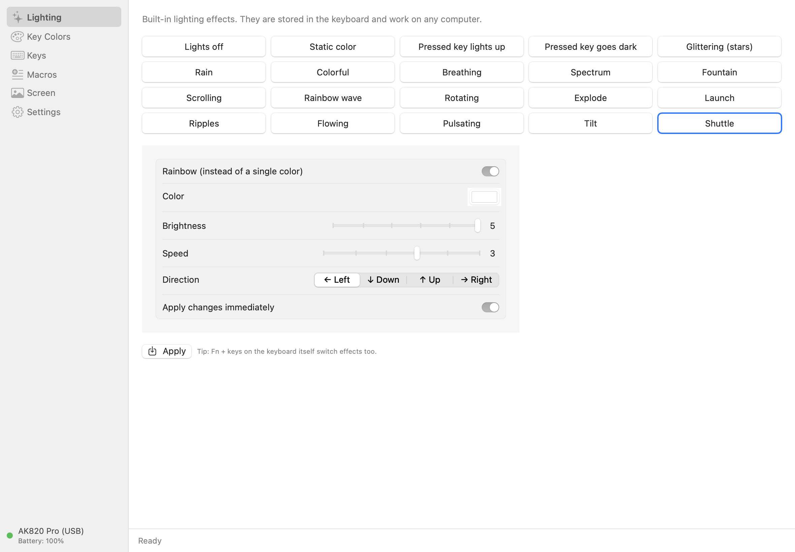
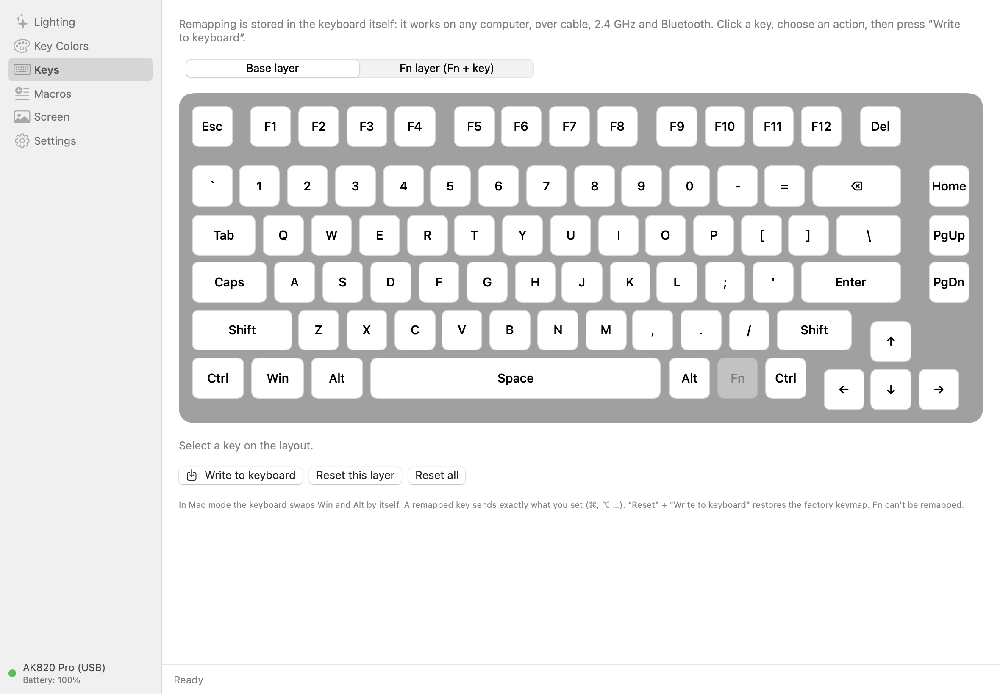
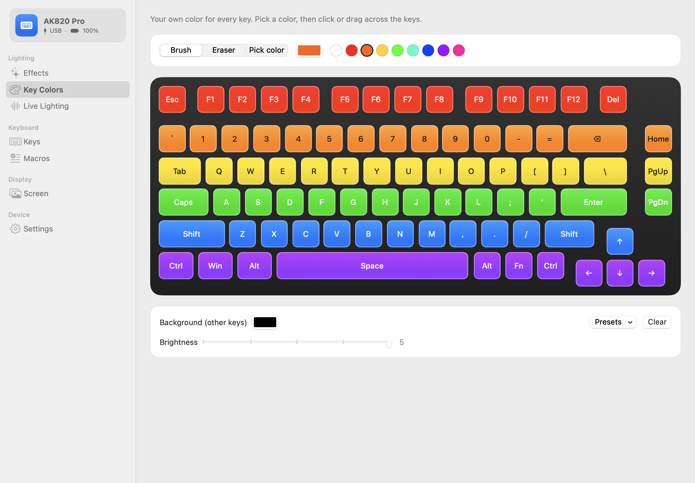
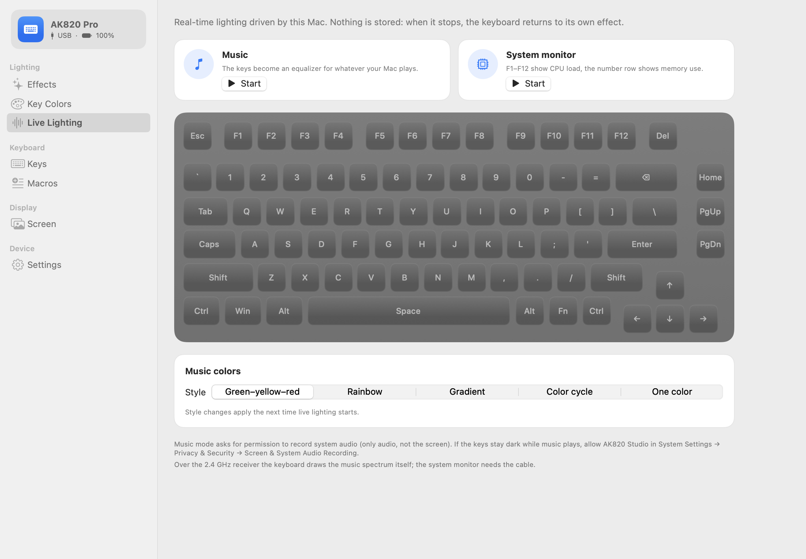
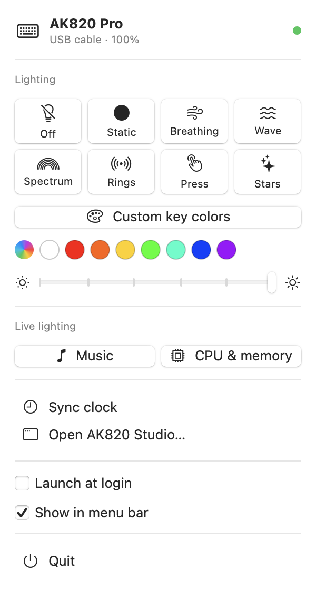
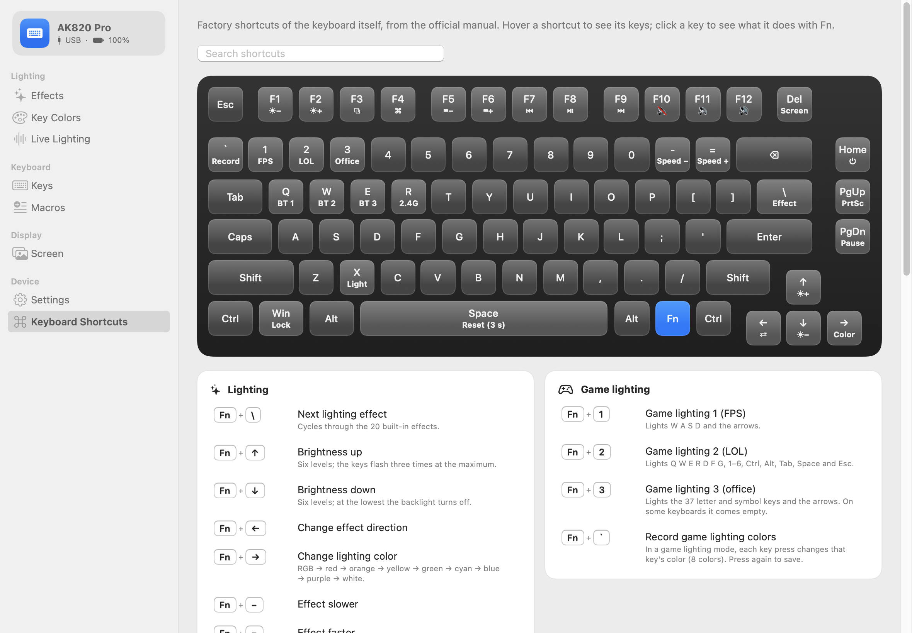

# AK820 Studio

**Native macOS configurator for the AJAZZ AK820 Pro keyboard** — no Windows, no browser.

[Русская версия](README.ru.md)

The vendor's configuration software exists only for Windows (plus a very limited web app).
AK820 Studio does the same job natively on macOS, talking to the keyboard over USB HID.



## Keyboard

AJAZZ AK820 Pro — 75 % gasket-mount mechanical keyboard, 81 keys, knob, 0.85″ TFT screen,
tri-mode (USB-C / 2.4 GHz / Bluetooth). Also sold as EPOMAKER × AJAZZ and ATTACK SHARK × AJAZZ.

- AJAZZ official store: <https://ajazzstore.com/products/ajazz-ak820-pro>
- AJAZZ official website (drivers, manuals): <https://www.a-jazz.com/en/search.jsp?id=422&q=ak820>
- EPOMAKER: <https://epomaker.com/products/ajazz-ak820-pro>
- ATTACK SHARK: <https://attackshark.com/products/attackshark-ajazz-ak820-pro-75-mechanical-keyboard>
- User manual: <https://manuals.plus/asin/B0CMWKN55N>, official PDF: <https://epomaker.com/cdn/shop/files/AK820_PRO_manual.pdf>

Supported USB IDs: VID `0C45` (SONiX), PID `8009` / `800A` (wired).

## Features

| Page | What it does |
|---|---|
| Effects | 19 built-in effects with an animated preview; color or rainbow, brightness, speed, direction; applied instantly |
| Key Colors | per-key RGB: paint by clicking or dragging, eyedropper, gradient presets |
| Live Lighting | **music equalizer** from the system audio, **system monitor** (CPU on F1–F12, memory on the number row) |
| Keys | remap the base and Fn layers: key / shortcut, media, mouse, macro, disable; "press to pick"; list of changed keys |
| Macros | text, key combinations, pauses, mouse clicks, **recording from the Mac keyboard**; once / N times / toggle / while held / step |
| Screen | image or GIF (up to 140 frames) into **one of three slots** of the 128×128 screen; clock sync |
| Settings | sleep timer, Fn mode, debounce, Win / Alt+Tab / Alt+F4 locks, firmware version, **factory reset with undo**, "write everything again", language, export / import |
| Keyboard Shortcuts | every factory Fn shortcut from the official manual on an interactive keyboard map: hover to highlight keys, click a key, search; marks shortcuts replaced by your remaps |
| Menu bar | quick effects, colors, brightness, live lighting, clock sync, launch at login |

Pages with changes that are not written to the keyboard yet are marked with a dot; **⌘S** writes the current page.

Everything is stored **in the keyboard** and keeps working on any computer and any connection.

### Connections

| | USB cable | 2.4 GHz receiver | Bluetooth |
|---|---|---|---|
| Effects, keys, macros, settings, clock | ✅ | ✅ | — |
| Per-key colors, screen, system monitor | ✅ | — | — |
| Music lighting | ✅ (drawn by the app) | ✅ (drawn by the keyboard) | — |

The cable wins when both are connected. Over the receiver the keyboard may be asleep: press a key to wake it up.

| Keys | Key colors |
|---|---|
|  |  |

| Live lighting | Menu bar |
|---|---|
|  |  |



Languages: English, Russian. Adding a language is one file — see [TRANSLATING.md](TRANSLATING.md).

## Build and install

Requires macOS 14+ and Xcode (SwiftUI macros need the full Xcode toolchain, Command Line Tools are not enough).

```sh
git clone https://github.com/usharik/ak820-studio.git
cd ak820-studio
./scripts/build-app.sh
cp -R "dist/AK820 Studio.app" /Applications/
```

The app is ad-hoc signed. If macOS refuses to open it: right-click → Open.

Command-line tool: `dist/ak820ctl` (`info`, `battery`, `clock`, `lights`, `image`; `-v` prints the packets).

## How it works

- `Sources/AK820Kit` — the protocol: IOKit HID, 64-byte feature reports on the vendor interface
  `0xFF13`, screen data in 4096-byte output reports on `0xFF68`; over the receiver (`0C45:FDFD`)
  32-byte output reports on `0xFF60`, each echoed back.
- Music lighting listens to the system audio with a Core Audio process tap (macOS 14.2+, asks for the
  "System Audio Recording" permission) and runs an FFT with Accelerate.
- `Sources/AK820Studio` — SwiftUI app. The keyboard can't report its settings back, so the last
  written state is kept in `~/Library/Application Support/AK820Studio/config.json`.
- `Sources/ak820ctl` — CLI.
- `Localization/*.lproj` — translations.

## Status

Verified on a real AK820 Pro (PID `8009`, firmware 1.14): detection, battery level, clock sync.
The other features follow packet formats that were verified on this keyboard model by the projects
below, but have had little testing in this app yet. If something doesn't work, open
**Settings → Keyboard communication log** and file an issue with its contents.

To go back to factory defaults: **Settings → Reset keyboard to factory defaults…** (can be undone),
or on the keyboard itself hold **Fn + Space** for 3–5 seconds.

Firmware updates are not supported: the vendor only offers Windows tools, and newer firmware uses a
different protocol (`0xFF67`) that this app doesn't speak. To replace the firmware with QMK, see
[fpb/ajazz-ak820-pro](https://github.com/fpb/ajazz-ak820-pro).

## Credits and materials used

The protocol was reverse-engineered by the community from the official Windows driver
(`DeviceDriver.exe` v1.0.0.5). AK820 Studio is a new implementation built on that work:

- [gha-projects/ak820-mac](https://github.com/gha-projects/ak820-mac) — macOS tool for the AK820 Pro;
  hardware-verified packet sequences, checksums, macro format, settings packet (main reference).
- [Twyx22/ak820-center](https://github.com/Twyx22/ak820-center) — Linux app; `PROTOCOL.md` and the
  official key layout (`rgb-keyboard.xml`) from which the key map here was generated.
- [wsclx/ak820pro-modder](https://github.com/wsclx/ak820pro-modder) and
  [adamauthor/ak820pro-modder](https://github.com/adamauthor/ak820pro-modder) — protocol research on both firmware families.
- [igordev96/AJAZZ-AK820-Pro-Driver](https://github.com/igordev96/AJAZZ-AK820-Pro-Driver) — WebHID configurator.
- [hcristosm/ak820-linux](https://github.com/hcristosm/ak820-linux) — Linux tool (RGB, screen, clock).
- [fpb/ajazz-ak820-pro](https://github.com/fpb/ajazz-ak820-pro) — hardware notes and a QMK port.

The 2.4 GHz receiver protocol and the music spectrum analyzer follow ak820-mac
(`docs/receptor-24g.md`, `musica/espectro.swift`).

Earlier community work these projects build on:
[gohv/EPOMAKER-Ajazz-AK820-Pro](https://github.com/gohv/EPOMAKER-Ajazz-AK820-Pro),
[TaxMachine/ajazz-keyboard-software-linux](https://github.com/TaxMachine/ajazz-keyboard-software-linux),
[KyleBoyer/TFTTimeSync-node](https://github.com/KyleBoyer/TFTTimeSync-node),
[Aiacos/ajazz-control-center](https://github.com/Aiacos/ajazz-control-center),
[gusleig/ajazz-ak820-pro-mac](https://github.com/gusleig/ajazz-ak820-pro-mac),
[MemerGamer/AjazzAk820ProUnofficialWebdriver](https://github.com/MemerGamer/AjazzAk820ProUnofficialWebdriver).

See [THIRD_PARTY_NOTICES.md](THIRD_PARTY_NOTICES.md).

Unofficial project, not affiliated with AJAZZ or EPOMAKER. Use at your own risk.

## License

MIT — see [LICENSE](LICENSE).
