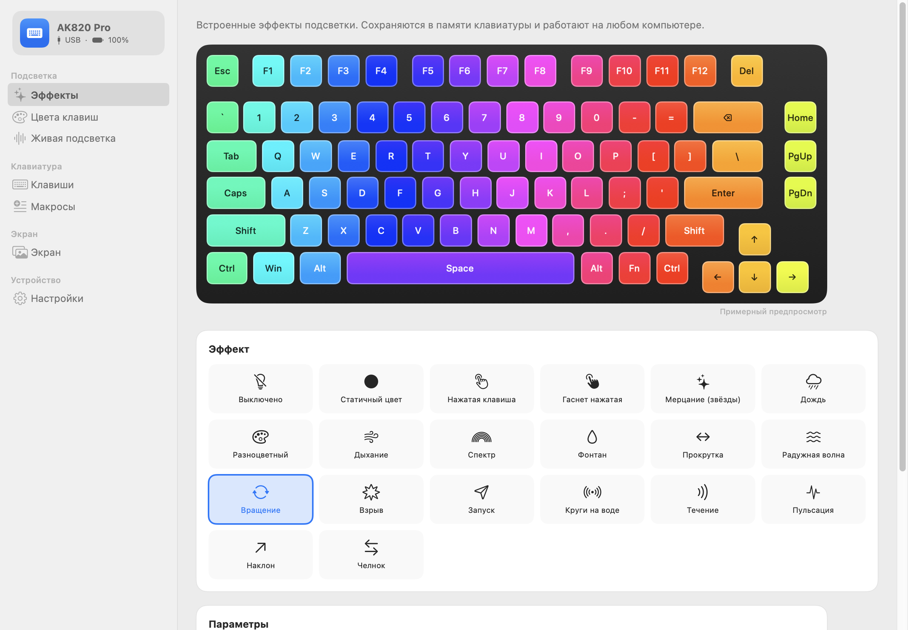

# AK820 Studio

**Нативное приложение для macOS для настройки клавиатуры AJAZZ AK820 Pro** — без Windows и браузера.

[English version](README.md)

Фирменная программа настройки есть только под Windows (и очень ограниченное веб-приложение).
AK820 Studio делает то же самое нативно на macOS, общаясь с клавиатурой по USB HID.



## Клавиатура

AJAZZ AK820 Pro — механическая клавиатура 75 % на гаскете, 81 клавиша, крутилка, экран TFT 0,85″,
три режима подключения (USB-C / 2,4 ГГц / Bluetooth). Продаётся также как EPOMAKER × AJAZZ и ATTACK SHARK × AJAZZ.

- Официальный магазин AJAZZ: <https://ajazzstore.com/products/ajazz-ak820-pro>
- Официальный сайт AJAZZ (драйверы, инструкции): <https://www.a-jazz.com/en/search.jsp?id=422&q=ak820>
- EPOMAKER: <https://epomaker.com/products/ajazz-ak820-pro>
- ATTACK SHARK: <https://attackshark.com/products/attackshark-ajazz-ak820-pro-75-mechanical-keyboard>
- Инструкция: <https://manuals.plus/asin/B0CMWKN55N>, официальный PDF: <https://epomaker.com/cdn/shop/files/AK820_PRO_manual.pdf>

Поддерживаемые USB ID: VID `0C45` (SONiX), PID `8009` / `800A` (по кабелю).

## Возможности

| Раздел | Что умеет |
|---|---|
| Эффекты | 19 встроенных эффектов с анимированным предпросмотром; цвет или радуга, яркость, скорость, направление; применяется сразу |
| Цвета клавиш | свой цвет каждой клавиши: кликом или протягиванием, пипетка, градиентные шаблоны |
| Живая подсветка | **эквалайзер** по системному звуку, **монитор системы** (процессор на F1–F12, память на ряду цифр) |
| Клавиши | основной слой и слой Fn: клавиша / сочетание, мультимедиа, мышь, макрос, отключение; список изменённых клавиш |
| Макросы | текст, сочетания, паузы, клики мыши, **запись нажатий с клавиатуры Mac**; один раз / N раз / по кругу / пока зажата / по шагу |
| Экран | картинка или GIF (до 140 кадров) в **один из трёх слотов** экрана 128×128; синхронизация часов |
| Настройки | автосон, режим Fn, защита от дребезга, блокировки, версия прошивки, **сброс к заводским с отменой**, «записать всё заново», язык, экспорт / импорт |
| Сочетания клавиш | все заводские Fn-сочетания по официальной инструкции на интерактивной схеме: наведение подсвечивает клавиши, клик по клавише, поиск; отмечает сочетания, заменённые вашими переназначениями |
| Строка меню | быстрые эффекты, цвета, яркость, живая подсветка, часы, автозапуск |

Разделы с изменениями, ещё не записанными в клавиатуру, отмечены точкой; **⌘S** записывает текущий раздел.

Всё сохраняется **в самой клавиатуре** и работает на любом компьютере и при любом подключении.

### Подключения

| | Кабель USB | Приёмник 2,4 ГГц | Bluetooth |
|---|---|---|---|
| Эффекты, клавиши, макросы, настройки, часы | ✅ | ✅ | — |
| Цвета клавиш, экран, монитор системы | ✅ | — | — |
| Подсветка под музыку | ✅ (рисует приложение) | ✅ (рисует клавиатура) | — |

Если подключены оба, используется кабель. Через приёмник клавиатура может спать — нажмите любую клавишу.

Языки: английский, русский. Новый язык — это один файл, см. [TRANSLATING.md](TRANSLATING.md).

## Сборка и установка

Нужны macOS 14+ и Xcode (макросам SwiftUI нужен полный тулчейн Xcode, одних Command Line Tools мало).

```sh
git clone https://github.com/usharik/ak820-studio.git
cd ak820-studio
./scripts/build-app.sh
cp -R "dist/AK820 Studio.app" /Applications/
```

Приложение подписано ad-hoc. Если macOS не даёт его открыть: правый клик → «Открыть».

Утилита для терминала: `dist/ak820ctl` (`info`, `battery`, `clock`, `lights`, `image`; `-v` показывает пакеты).

## Состояние

Проверено на настоящей AK820 Pro (PID `8009`, прошивка 1.14): обнаружение, заряд батареи, синхронизация часов.
Остальные функции используют форматы пакетов, проверенные на этой модели в проектах ниже, но в этом
приложении пока протестированы мало. Если что-то не работает, откройте
**Настройки → Журнал обмена с клавиатурой** и приложите его содержимое к issue.

Вернуть заводские настройки: **Настройки → Сбросить клавиатуру к заводским…** (можно отменить)
или на самой клавиатуре удерживать **Fn + Пробел** 3–5 секунд.

Обновление прошивки не поддерживается: производитель выпускает инструменты только для Windows, а новые
прошивки используют другой протокол (`0xFF67`). Заменить прошивку на QMK:
[fpb/ajazz-ak820-pro](https://github.com/fpb/ajazz-ak820-pro).

## Благодарности и использованные материалы

Протокол восстановлен сообществом по официальному драйверу для Windows (`DeviceDriver.exe` v1.0.0.5).
AK820 Studio — новая реализация на основе этой работы:

- [gha-projects/ak820-mac](https://github.com/gha-projects/ak820-mac) — утилита для AK820 Pro на macOS;
  проверенные на железе последовательности пакетов, контрольные суммы, формат макросов (основной источник).
- [Twyx22/ak820-center](https://github.com/Twyx22/ak820-center) — приложение для Linux; `PROTOCOL.md` и
  официальная раскладка (`rgb-keyboard.xml`), из которой сгенерирована схема клавиш.
- [wsclx/ak820pro-modder](https://github.com/wsclx/ak820pro-modder) и
  [adamauthor/ak820pro-modder](https://github.com/adamauthor/ak820pro-modder) — исследование протокола обеих версий прошивки.
- [igordev96/AJAZZ-AK820-Pro-Driver](https://github.com/igordev96/AJAZZ-AK820-Pro-Driver) — конфигуратор на WebHID.
- [hcristosm/ak820-linux](https://github.com/hcristosm/ak820-linux) — утилита для Linux (RGB, экран, часы).
- [fpb/ajazz-ak820-pro](https://github.com/fpb/ajazz-ak820-pro) — описание железа и порт QMK.

Протокол приёмника 2,4 ГГц и анализатор спектра для музыки — по ak820-mac
(`docs/receptor-24g.md`, `musica/espectro.swift`).

Более ранние работы сообщества, на которых построены эти проекты:
[gohv/EPOMAKER-Ajazz-AK820-Pro](https://github.com/gohv/EPOMAKER-Ajazz-AK820-Pro),
[TaxMachine/ajazz-keyboard-software-linux](https://github.com/TaxMachine/ajazz-keyboard-software-linux),
[KyleBoyer/TFTTimeSync-node](https://github.com/KyleBoyer/TFTTimeSync-node),
[Aiacos/ajazz-control-center](https://github.com/Aiacos/ajazz-control-center),
[gusleig/ajazz-ak820-pro-mac](https://github.com/gusleig/ajazz-ak820-pro-mac),
[MemerGamer/AjazzAk820ProUnofficialWebdriver](https://github.com/MemerGamer/AjazzAk820ProUnofficialWebdriver).

См. [THIRD_PARTY_NOTICES.md](THIRD_PARTY_NOTICES.md).

Неофициальный проект, не связан с AJAZZ или EPOMAKER. Используйте на свой страх и риск.

## Лицензия

MIT — см. [LICENSE](LICENSE).
